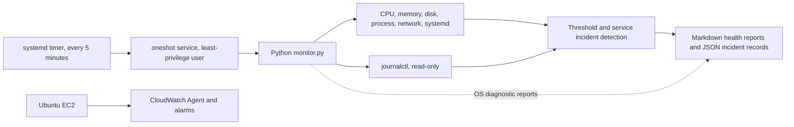

# Architecture

Linux Sentinel collects OS-level diagnostic context. CloudWatch separately collects configured AWS and guest metrics; the agent and IAM permissions must be installed/configured explicitly.
